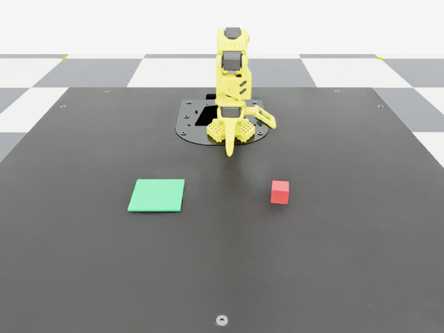

# SO-101 block pick-and-place in Isaac Sim → GR00T N1.7 post-training

An Isaac Lab 3.0 / Isaac Sim 6.1 environment in which a TheRobotStudio **SO-101** arm picks a
3D-printed block and places it on a target pad, plus everything needed to turn that into a
**GR00T N1.7** post-training loop:

* a scripted expert that records demonstrations straight into a **LeRobot v2.1** dataset
  (front + wrist camera videos, LeRobot-style joint units) — no teleop hardware needed;
* an optional leader-arm teleop variant (IsaacTeleop) + HDF5→LeRobot converter;
* GR00T N1.7 modality config / `modality.json` and the fine-tune, serve and
  **closed-loop sim evaluation** scripts (ZeroMQ client, success rate over N episodes);
* the printable block set (STL) and its Isaac-ready USD twins, so the simulated block matches
  the one you print for the real arm.

It follows the Hugging Face blog *[GR00T N1.5 SO-101 tuning](https://huggingface.co/blog/nvidia/gr00t-n1-5-so101-tuning)*
(dataset layout, `modality.json`, `new_embodiment` tag, front+wrist cameras, finetune / inference /
eval flow, updated to the N1.7 CLI) and NVIDIA's *[GR00T end-to-end workflow – simulation](https://docs.nvidia.com/learning/physical-ai/gr00t-e2e-workflow/latest/simulation-workflow/groot-fine-tuning-sim.html)*
(record in Isaac Lab → export LeRobot → fine-tune with the LLM frozen → closed-loop sim eval over
ZeroMQ), with the Arena/G1 pieces replaced by SO-101 equivalents.



## Contents

| Path | What |
|---|---|
| `so101_pickplace/` | Isaac Lab task package: env config (3 variants), MDP terms, scripted expert, LeRobot writer, GR00T client, unit conventions |
| `scripts/` | `collect_demos.py`, `eval_in_sim.py`, `hdf5_to_lerobot.py`, `view_env.py` (diagnostics), `calibrate_grasp.py` |
| `gr00t/` | `so101_sim_config.py` (modality config), `modality.json`, `check_dataset.py` |
| `assets/cube_blocks/` | printable blocks (`stl/`), Isaac USD twins (`usd/`), `manifest.json` |
| `nebius/` | `create_vm.sh` (Nebius CLI) and `setup_vm.sh` (Isaac Sim + Isaac Lab + GR00T install) |
| `*.sh`, `env.sh` | pipeline wrappers; every knob is in `env.sh` |

Gym ids: `Isaac-PickPlace-Cube-SO101-IK-v0` (pose-IK action, used by the expert),
`Isaac-PickPlace-Cube-SO101-Joint-v0` (absolute joint targets, what GR00T outputs — used for eval
and teleop conversion), `Isaac-PickPlace-Cube-SO101-Joint-Teleop-v0` (leader arm via IsaacTeleop).

## Requirements

* Linux x86_64 (or DGX Spark aarch64, where this was developed), NVIDIA GPU **with RT cores** for
  Isaac Sim rendering (L40S, RTX PRO 6000, RTX 6000 Ada, GeForce RTX; **not** H100/H200), ≥ 48 GB
  GPU memory to fine-tune N1.7-3B comfortably (NVIDIA recommends 40 GB+, the HF blog ran in ~25 GB).
* Isaac Sim 6.1 + Isaac Lab 3.0 in a Python 3.12 venv (`pip install isaacsim[all,extscache]==6.1.0
  --extra-index-url https://pypi.nvidia.com`, then `IsaacLab/isaaclab.sh --install`), plus
  `pip install pyzmq msgpack msgpack-numpy h5py imageio pyarrow` into that venv. ffmpeg on PATH.
* [Isaac-GR00T](https://github.com/NVIDIA/Isaac-GR00T) (N1.7) with its own `uv` venv, the
  `nvidia/GR00T-N1.7-3B` weights, and Hugging Face access to the gated `nvidia/Cosmos-Reason2-2B`
  backbone (`huggingface-cli login`).
* Internet access on first run: Isaac Lab fetches the SO-101 and table USDs from NVIDIA's asset server.

`nebius/setup_vm.sh` performs all of the above on a fresh Ubuntu 24.04 CUDA VM.

## Quick start

```bash
git clone https://github.com/ddiddi/so101-sim-pickplace-gr00t.git
cd so101-sim-pickplace-gr00t
$EDITOR env.sh                      # ISAACLAB_PY, ISAACLAB_DIR, GR00T_REPO, dataset name, task text

source env.sh
$ISAACLAB_PY scripts/view_env.py --run_policy 600 --viz kit   # watch the expert in the Isaac Sim window
./collect.sh                        # 1. scripted demos -> LeRobot v2.1 (NUM_EPISODES successful episodes, headless)
./prepare_dataset.sh                # 2. modality.json + GR00T stats + loader sanity check
./finetune.sh                       # 3. N1.7-3B post-training (4000 steps @ batch 16)
./start_server.sh                   # 4. terminal 1: policy server on the latest checkpoint
./eval.sh --num_episodes 20         # 5. terminal 2: closed-loop success rate in sim (--viz kit to watch, --record_dir to save mp4s)
```

`--viz kit` opens the Isaac Sim window for any sim script; without it everything runs headless
(cameras still render). `collect.sh --resume` appends to an existing dataset.

## The environment

* SO-101 (`SO101_HIGH_PD_CFG`, gentle effort-limited gripper) seated on the SeattleLab table exactly
  like the Isaac Lab contrib `IsaacContrib-Stack-Cube-SO101-*` tasks; reset pose has the jaws
  pointing straight down. 30 Hz control (60 Hz PhysX, decimation 2) = LeRobot's 30 fps.
* **Block**: `assets/cube_blocks/usd/cube_30mm_red.usda` — generated from the same mesh as the
  printable `stl/cube_30mm.stl` (1 mm chamfer, PLA mass estimate, convex-hull collision, PLA
  friction). `CUBE_SIZE_MM=25|30|40` and `CUBE_COLOR=red|green|blue|yellow` select another twin.
  Spawned at random on the +Y half of the workspace with random yaw; a 90 mm green pad spawns on
  the −Y half.
* **Cameras**: `front` (fixed, 640×480, looking at the arm over the table) and `wrist` (640×480 on
  the gripper link, looking down the jaws) — the two keys of the SO-100 GR00T modality config.
* **Success**: block resting inside the pad footprint, jaw open, grasp point clear of the block.
* **Expert** (`scripted_policy.py`): open → hover → descend → close → lift (with a lift check and
  up to two re-grasps) → hover pad → lower → release → retreat, in task space through the
  contrib SO-101 full-pose IK; grasp orientation = straight down, spun about Z to match the block
  yaw (mod 90°). Hover heights and waypoints are jittered per episode.
* The grasp point on the gripper link (`GRASP_POINT_OFFSET`) was calibrated empirically with
  `scripts/calibrate_grasp.py` (sweep offsets, keep what lifts the block); re-run it if you change
  the block size or the robot asset.
* Measured on the development machine (DGX Spark, PhysX, headless): the expert succeeds on ~75 %
  of random scenes (6/8 in the probe run), episodes are ~300 frames (10 s at 30 Hz) and an attempt
  costs ~25 s wall-clock including rendering of both 640×480 cameras. Failed attempts are discarded,
  so `NUM_EPISODES` counts successful demonstrations.

## Dataset conventions

Same feature names and units as real LeRobot SO-101 recordings: `observation.state` / `action`
= `[shoulder_pan.pos, …, wrist_roll.pos, gripper.pos]`, arm joints mapped from the USD joint
limits to `[-100, 100]`, gripper from closed…open to `[0, 100]` (`so101_units.py`). `state` is the
measured joint position, `action` the joint target commanded at that frame (IK output for the
expert, leader angle for teleop). Videos: h264 mp4, 30 fps, 640×480. `prepare_dataset.sh` adds
`meta/modality.json` and runs `gr00t/data/stats.py` (`stats.json`, `relative_stats.json`) then
loads the dataset with GR00T's own `LeRobotEpisodeLoader` as a check.

## Fine-tuning notes

* `finetune.sh` = `examples/finetune.sh` with `--no-tune-llm --tune-visual --tune-projector
  --tune-diffusion-model` (NVIDIA sim recipe), batch 16, 4000 steps, checkpoint every 1000.
  Override with `MAX_STEPS=… GLOBAL_BATCH_SIZE=… SAVE_STEPS=… ./finetune.sh`; add
  `--no-tune-diffusion-model` if memory is tight.
* The 16-step action horizon in `gr00t/so101_sim_config.py` is baked into the diffusion head at
  training time and cannot be changed at inference; the server is started with the same modality
  config, and `eval.sh --action_horizon N` only picks how many of the 16 predicted steps execute
  before re-querying (8 by default).
* Verify the layout on a short recording before bulk collection (`NUM_EPISODES=3 ./collect.sh &&
  ./prepare_dataset.sh`). 30–50 clean real episodes is the usual sweet spot; sim demos are free, so
  100–200 with randomised poses is reasonable.
* Because the joint units mirror the real LeRobot convention, a sim-trained checkpoint can be
  served to the real arm with the same client contract (`gr00t/eval/real_robot/SO100/eval_so100.py`
  style); expect a visual sim-to-real gap.

## Leader-arm teleop (optional)

`Isaac-PickPlace-Cube-SO101-Joint-Teleop-v0` mirrors a physical SO-101 leader onto the sim
follower through IsaacTeleop's `so101_leader` device (same pipeline as the contrib stack teleop
task). It needs the optional `isaacteleop` package and the leader plugin streaming collection id
`so101_leader`:

```bash
./record_teleop.sh                      # Isaac Lab record_demos.py -> HDF5  (B start, P pause, R reset)
$ISAACLAB_PY scripts/hdf5_to_lerobot.py --hdf5 <file.hdf5> --dataset_root $DATASET_ROOT --task_text "$TASK"
```

## Running on Nebius AI Cloud

Isaac Sim needs RT cores, so use an **L40S** (`gpu-l40s-a` / `gpu-l40s-d`, `eu-north1`) or
**RTX PRO 6000** (`gpu-rtx6000`, `us-central1`; `gpu-rtx6000-a` in `uk-south2` / `eu-south1`) VM.
Do not use H100/H200 for the simulation part (Nebius' own Isaac Lab guide says the same). A single
L40S (48 GB) runs the whole loop: collection, N1.7-3B fine-tuning (batch 8–16), serving and sim eval.

### 1. Create the VM (Nebius CLI)

Install the [Nebius CLI](https://docs.nebius.com/cli/install), authenticate (`nebius profile
create`), pick a project, then:

```bash
NAME=so101-sim PLATFORM=gpu-l40s-d PRESET=1gpu-16vcpu-96gb ./nebius/create_vm.sh
# RTX PRO 6000 (us-central1):
# NAME=so101-sim PLATFORM=gpu-rtx6000 PRESET=1gpu-24vcpu-218gb ./nebius/create_vm.sh
```

The script creates a 300 GB `ubuntu24.04-cuda13.0` boot disk, the instance with a public IP, a
cloud-init user with your `~/.ssh/id_ed25519.pub`, and prints the `ssh` command. It is a thin
wrapper over the documented commands:

```bash
BOOT_DISK_ID=$(nebius compute disk create --name so101-boot --size-gibibytes 300 --type network_ssd \
  --source-image-family-image-family ubuntu24.04-cuda13.0 --block-size-bytes 4096 --format jsonpath='{.metadata.id}')
SUBNET_ID=$(nebius vpc subnet list --format jsonpath='{.items[0].metadata.id}')
nebius compute instance create --name so101-sim --resources-platform gpu-l40s-d --resources-preset 1gpu-16vcpu-96gb \
  --boot-disk-existing-disk-id "$BOOT_DISK_ID" --boot-disk-attach-mode READ_WRITE \
  --cloud-init-user-data "$USER_DATA" \
  --network-interfaces "[{\"name\": \"default-subnet\", \"subnet_id\": \"$SUBNET_ID\", \"ip_address\": {}, \"public_ip_address\": {}}]"
```

Presets (from the Nebius platform docs): `gpu-l40s-a`: `1gpu-8vcpu-32gb` … `1gpu-40vcpu-160gb`;
`gpu-l40s-d`: `1gpu-16vcpu-96gb` … `4gpu-192vcpu-1152gb`; `gpu-rtx6000`: `1gpu-24vcpu-218gb`,
`8gpu-192vcpu-1744gb`. Pick ≥ 64 GB RAM for Isaac Sim + GR00T. If `gpu-l40s-a` reports
`NotEnoughResources`, retry on `gpu-l40s-d` (the same capacity note is in Nebius' Isaac Lab guide).
Preemptible instances are cheaper but can be stopped at any time: keep datasets and checkpoints in
Nebius Object Storage (S3-compatible, `https://storage.eu-north1.nebius.cloud`) and use
`collect.sh --resume` / `finetune.sh --resume-from-checkpoint`.

### 2. Install the stack on the VM

```bash
ssh ubuntu@<public-ip>
curl -sL https://raw.githubusercontent.com/ddiddi/so101-sim-pickplace-gr00t/main/nebius/setup_vm.sh | bash
```

`setup_vm.sh` installs system deps, Isaac Sim 6.1 (pip) + Isaac Lab 3.0.0 into `~/work/env_isaaclab`,
Isaac-GR00T (uv, Python 3.12) with the N1.7-3B weights into `~/work/Isaac-GR00T`, and clones this
repo into `~/work/so101_sim_pickplace`. It pauses once for `huggingface-cli login` (the
Cosmos-Reason2-2B backbone is gated: accept its terms on the Hub first). Then edit `env.sh`:

```bash
export ISAACLAB_PY=$HOME/work/env_isaaclab/bin/python
export ISAACLAB_DIR=$HOME/work/IsaacLab
export GR00T_REPO=$HOME/work/Isaac-GR00T
```

and in `gr00t_activate` drop the two DGX-Spark-only lines (`activate_spark.sh`, `nvpl`) — on x86_64
`source .venv/bin/activate` is enough.

### 3. Run the loop headless

```bash
cd ~/work/so101_sim_pickplace && source env.sh
export OMNI_KIT_ACCEPT_EULA=YES
NUM_EPISODES=3 ./collect.sh && ./prepare_dataset.sh       # smoke test (first run downloads assets, ~5 min)
NUM_EPISODES=100 ./collect.sh --resume                     # ~20 s per episode on an L40S
./prepare_dataset.sh
GLOBAL_BATCH_SIZE=8 MAX_STEPS=6000 ./finetune.sh           # ~3-4 h on one L40S; batch 16 fits on RTX PRO 6000
./start_server.sh &                                        # same VM, port 5555
./eval.sh --num_episodes 50 --record_dir logs/eval         # success rate + mp4 per episode
```

To watch the Isaac Sim window from your laptop, run the sim scripts with `--viz kit` under a
virtual display (`sudo apt-get install xvfb; xvfb-run -s "-screen 0 1920x1080x24" …`) and stream
with `--livestream 2` (WebRTC) — or just inspect `logs/eval/*.mp4` and `logs/view/*.png`.

Sync results off the VM: `aws s3 sync datasets/ s3://<bucket>/so101/datasets --endpoint-url
https://storage.eu-north1.nebius.cloud` (Object Storage keys from the Nebius console), or `rsync`.

### Using the Nebius Physical AI workbench (`npa`)

If your team uses [nebius-physical-ai](https://github.com/nebius/nebius-physical-ai), `npa workbench
isaac-lab deploy` / `npa workbench groot deploy` provision the same kind of RT-core VM with Isaac
Lab / GR00T preinstalled (`--gpu-type gpu-l40s-d --gpu-preset …`, `--no-preemptible` for long
training), and the Isaac Lab BYOF cookbook shows how to layer this repo into their container image.
This repo does not depend on `npa`; the plain-VM path above is sufficient.

### Delete the VM

```bash
nebius compute instance delete --id <VM_ID>
nebius compute disk delete --id <BOOT_DISK_ID>
```

## Development notes

* `scripts/view_env.py` prints joint order/limits, body names, the grasp-point and jaw poses, mesh
  bounds of both jaws in the gripper frame, and dumps camera frames to `logs/view/`; use it after
  any asset or camera change.
* The scripts never let the env auto-reset: terminations are disabled and episodes are ended by
  the script (success / drop / timeout), so recordings are never cut by a reset.
* Physics is PhysX (the contrib SO-101 tuning); the Newton backend is not selected because these
  standalone scripts bypass Isaac Lab's Hydra preset resolution.

License: Apache-2.0. The SO-101 asset is NVIDIA's `so101_new_calib` USD; Isaac-GR00T and Isaac Lab
are Apache-2.0 / BSD-3-Clause respectively.
